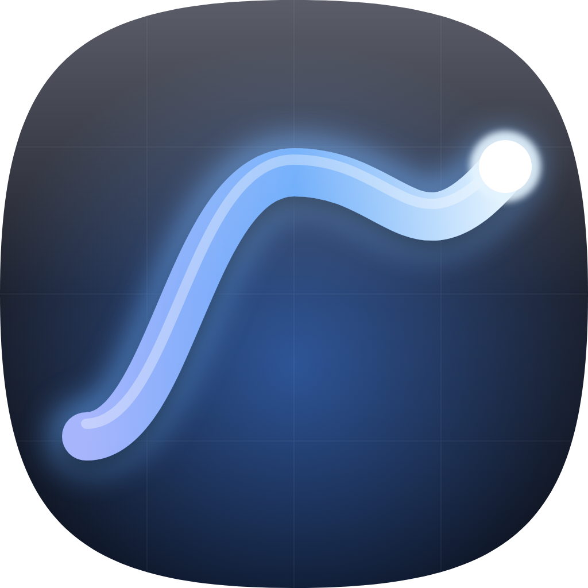
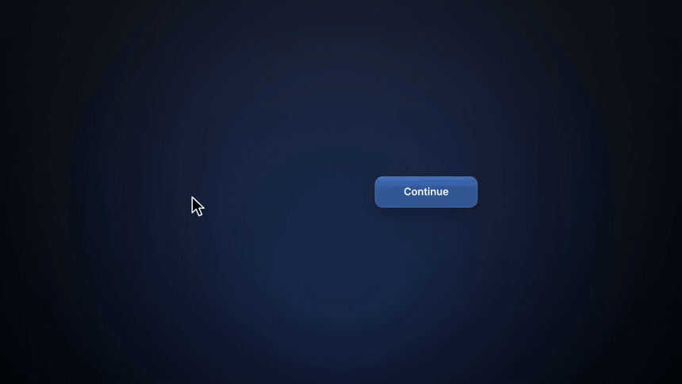

<p align="center">
  
</p>

<h1 align="center">Kinetic</h1>

<p align="center"><strong>Motion, tamed.</strong><br>
Your PC mouse and keyboard, finally feeling native on the Mac.</p>

<p align="center">
  
</p>

<p align="center">
  <a href="https://github.com/andretmarques/Kinetic/releases/latest/download/Kinetic.dmg"><strong>⬇ Download Kinetic for Mac</strong></a><br>
  <sub>Free and open source · macOS 26 or later · Apple silicon and Intel</sub>
</p>

You bought a great mouse and a great keyboard. Then you plugged them into a Mac: the pointer overshoots, the wheel scrolls backwards, the side buttons sit idle, ⌘ is in the wrong place and F11 does nothing.

Kinetic fixes all of that in a few clicks. No rules to write and no drivers to install. Set it once, then forget it's there.

## What you get

- **🎯 A pointer you can trust.** Set the speed and acceleration for each mouse, including truly linear movement with acceleration off.
- **🖱 Scrolling your way.** Reverse the mouse wheel without touching your trackpad, and choose how far each notch scrolls.
- **⚡️ Any button, any action.** Press a button on your mouse and give it a job: switch desktops, open Mission Control, control media, or launch an app or shortcut.
- **⌨️ A Mac keyboard, from any keyboard.** Swap Alt and Win so ⌘ sits where your hands expect it, and get Mac F-keys for brightness, Mission Control, Spotlight, media and volume.
- **🪟 At home on your Mac.** A Liquid Glass settings window, plus a menu bar panel for the things you change most.

## So light you'll forget it's there

|  |  |
|---|---|
| **~30 MB** | of memory in the background with the menu bar icon on |
| **~5 MB** | with the icon off, measured just after starting |
| **0%** | CPU while idle |
| **0** | drivers or system extensions |
| **~12 MB** | for the whole app |

The settings window closes completely when you're done. All that stays is one small background process that does nothing until you scroll, click or press a key.

## Moving from a PC? Keep your gear

Switching to a Mac shouldn't mean buying a new mouse and keyboard, or relearning your hands. Kinetic closes the gap in a few minutes.

| On a PC, you're used to | On a Mac, without Kinetic | With Kinetic |
|---|---|---|
| The wheel scrolling the way you expect | It scrolls the opposite way, tied to your trackpad | Reverse the wheel only. Your trackpad stays as it is |
| A pointer that moves as far as your hand does | One macOS pointer setting shared by every mouse | Acceleration off, per mouse, with a speed slider |
| Side buttons that do something | They often sit idle | Back and forward, desktops, or anything else you pick |
| The key beside the space bar being the one you reach for | That's Alt, but a Mac expects ⌘ there | Swap Alt and Win, and ⌘ sits where a Mac keyboard has it |
| Media and brightness on the top row | F-keys that do little or nothing | Brightness, Mission Control, Spotlight, media and volume |

**It's a safe thing to try.** There are no drivers to install. Your trackpad and your Mac's built-in key layout stay as they are. Pause Kinetic at any time and your mouse and keyboard go straight back to how macOS had them.

**The one habit to change:** Kinetic doesn't move Ctrl. On a Mac, most shortcuts use ⌘ instead of Ctrl, so with the swap on, your thumb does the work:

| To | Press |
|---|---|
| Copy, paste, undo | ⌘C, ⌘V, ⌘Z |
| Switch apps | ⌘Tab |
| Close a window, quit an app | ⌘W, ⌘Q |
| Search for anything | ⌘Space |
| Screenshot an area | ⌘⇧4 |

## Get started

1. **[Download Kinetic](https://github.com/andretmarques/Kinetic/releases/latest/download/Kinetic.dmg)**, open the file and drag **Kinetic** to **Applications**.
2. **Open Kinetic.** It takes you straight to System Settings, one permission at a time. Turn on **Kinetic Agent** under **Accessibility** and **Input Monitoring**. It needs these to see and change your scrolling, buttons and keys.
3. **Choose your setup.** The last step offers the usual fixes with one click each: acceleration off, the wheel reversed, side buttons for desktops, and the Alt and Win swap with Mac F-keys for each keyboard. Turn off anything you don't want.

That's it. Kinetic starts by itself when you log in, and your settings apply whenever a device connects.

## User guide

Everything lives in five sections of the settings window. Changes apply straight away.

### Pointer

- **Speed** runs from 1 to 20. Speed 10 is macOS's normal speed.
- **Acceleration** has three modes:
  - **Off:** the pointer moves the same distance however fast you move your hand. About speed 16 is 1:1 with your mouse.
  - **macOS:** small movements are precise and fast flicks travel further.
  - **Custom:** set your own **Curve**, from 0 (gentlest) to 3 (very aggressive).
- **Try it** gives you a target to test on, and **Use macOS Defaults** undoes it all.

### Scrolling

- **Reverse vertical scrolling** and **Reverse horizontal scrolling** change the mouse wheel only.
- **Change scroll speed** sets the lines per notch, from 1 to 10. macOS's normal speed is 3.

### Buttons

1. Open **Buttons** and press any button on your mouse. Its row lights up.
2. Click the action next to it, and pick or search for what it should do:
   - **Desktops:** next or previous desktop, Mission Control, App Exposé, Show Desktop
   - **System:** Spotlight, Notification Center, Lock Screen, screenshots, Dictation
   - **Navigation:** back, forward, tabs, close window, quit app
   - **Mouse:** middle click, right click, double click
   - **Media:** play, pause, tracks, volume, brightness
   - **Custom:** any keyboard shortcut, any app, or a macOS Shortcut
3. Leave the screen to use it. While **Buttons** is open, pressing a button only identifies it.

The left and right buttons can't be remapped. Jumping to a numbered desktop needs "Switch to Desktop" turned on in **System Settings → Keyboard → Keyboard Shortcuts → Mission Control**.

**Using more than one mouse?** Pick one with the mouse menu at the top of the window to give it its own settings, or leave it on **All Mice**.

### Keyboard

Each external keyboard gets its own switches:

- **Use Mac layout** swaps Alt and Win.
- **Mac-style F-keys** turns on the top row actions below.

| F1, F2 | F3 | F4 | F5 | F6 | F7, F8, F9 | F10, F11, F12 |
|---|---|---|---|---|---|---|
| Brightness | Mission Control | Spotlight | Dictation | Stays F6 | Previous, play or pause, next | Mute, volume down, volume up |

Click any key in the grid to give it a different action. F-key settings apply to every keyboard, including Fn+F-keys on your Mac's own, because macOS doesn't say which keyboard a key came from.

**Need a real F5?** A PC keyboard's Fn key never reaches macOS, so hold **Right Control** to get the other mode, or choose a different key under **Hold for the other mode**. Double-tap that key to flip the mode until you double-tap it again, pause Kinetic, or the Mac-F-key keyboard disconnects. You can also make standard F1–F12 the default under **F-keys do**.

### General

- **Keep Kinetic on** starts it at login.
- **Pause all changes** puts everything back to macOS's behaviour until you turn it off.
- **Show menu bar icon** adds a panel with quick switches for Kinetic, reverse scroll, acceleration and F-keys, plus a pointer speed slider. Turn it off to use the least memory.
- **Devices** lists what's connected. Some keyboards, mice and wireless receivers report themselves as both, so turn off whichever one yours isn't.
- **Export** and **Import** move your settings to another Mac, **Reset to Defaults** clears them, and **Show setup again** reruns the setup.

## Run it locally

You'll need macOS 26, plus Xcode 26 or the Command Line Tools with the macOS 26 SDK.

```sh
git clone https://github.com/andretmarques/Kinetic.git
cd Kinetic
./build.sh
open build/Kinetic.app
```

macOS asks you to approve the permissions again after each rebuild.

## Good to know

- **Several mice at once:** pointer speed is set per mouse, but scrolling and buttons use your "All Mice" settings.
- **Password fields and the login window:** scrolling, buttons and F-keys don't apply there. The Alt and Win swap still does.
- **Brightness keys** control the built-in display only.
- **Pointer control** relies on a private macOS API, so a future macOS update could affect it.

## License

[MIT](LICENSE). Free to use, change and share.
